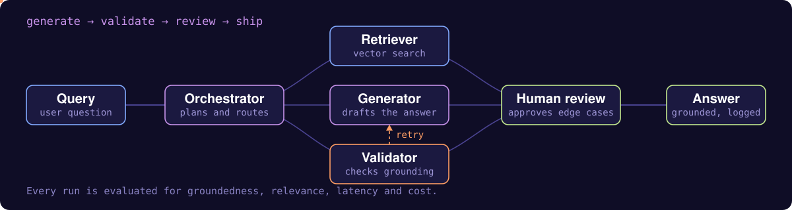

<div align="center">



<a href="https://www.linkedin.com/in/punam-subre-023856227"></a>


</div>

## `> whoami`

I'm an **AI / ML Engineer** who builds **multi-agent systems** that run in production across **finance, retail, manufacturing, and banking**.

Most people stop at the prompt. I go deeper: **agent orchestration, retrieval validation, human-in-the-loop controls, evaluation pipelines**. That is the unglamorous work that makes AI reliable.

My unfair advantage is that I started in **data engineering**. I've migrated legacy data platforms and built ETL at scale, so my AI systems sit on clean pipelines.

## `> how I build`

<div align="center">

</div>

## `> what I'm building`

```python
class PoonamSubre:

    role = "AI / ML Engineer"

    currently_building = [
        "Multi-agent systems with Google ADK & Vertex AI",
        "RAG pipelines with retrieval validation & grounding checks",
        "Agentic SDLC tools: CI/CD diagnosis, schema validation, secret detection",
    ]

    currently_learning = [
        "A2A & MCP protocols",
        "LangGraph for complex agent workflows",
        "Advanced agent evaluation & observability",
    ]

    domains = ["Financial Services", "Retail", "Manufacturing", "Banking"]

    fun_fact = "Equally happy debugging an agent or climbing a mountain trail"
```

## `> tech --stack`

<div align="center">

**🧠 Agentic AI**


**⚙️ Languages & Frameworks**


**☁️ Cloud & Data**


**🚀 DevOps & Deployment**


</div>

## `> stats`

<div align="center">

</div>

## `> certifications --verified`

<div align="center">

🟣 Gemini Enterprise Development · 🟣 Gemini Enterprise Agent Deployment\
🏅 Generative AI Leader · ☁️ Associate Cloud Engineer\
🤖 API Deployment Practitioner · 🤖 ChatGPT Deployment Practitioner

</div>

## `> life --outside-code`

🎵 Music · 🏔️ Mountains & Trekking · 🌍 Travelling. If there's a trail and a summit, I'm there.
